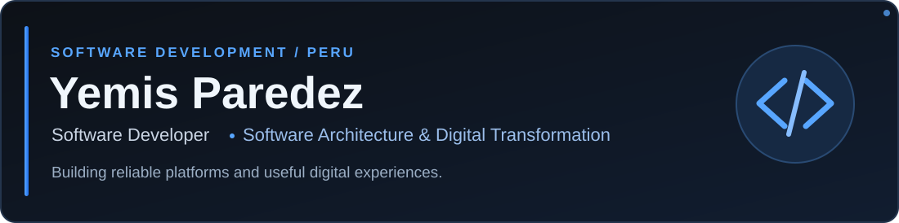

  

### About me

I'm **Yemis Paredez**, a **full-stack software developer** based in Peru. My main strengths are **business logic, relational database design with scalability in mind, backend development, and software architecture**. I also build intuitive interfaces, connecting robust technical foundations with practical user experiences.

I enjoy turning complex requirements into maintainable systems, including digital solutions that help organizations and public institutions work more efficiently.

**Have an idea, a project, or a technical challenge?** I'm open to collaborating as a development partner—whether you want to shape an idea, improve an existing system, or build a solution designed to grow.

Leer en español

Soy **Yemis Paredez**, **desarrollador de software full-stack** de Perú. Mis principales fortalezas son la **lógica de negocio, el diseño de bases de datos relacionales con criterios de escalabilidad, el desarrollo backend y la arquitectura de software**. También desarrollo interfaces intuitivas, integrando una base técnica sólida con experiencias de usuario funcionales.

Me interesa convertir requisitos complejos en sistemas mantenibles, incluidas soluciones digitales que ayuden a organizaciones e instituciones públicas a trabajar de forma más eficiente.

**¿Tienes una idea, un proyecto o un desafío técnico?** Estoy abierto a colaborar como aliado tecnológico, ya sea para dar forma a una idea, mejorar un sistema existente o construir una solución preparada para crecer.

  

### Tech stack

  

React · TypeScript · JavaScript · HTML · CSS · Node.js · NestJS · PHP · PostgreSQL · MySQL · Redis · Python · Git · Vite

---

<strong>IF YOU CAN IMAGINE IT, YOU CAN PROGRAM IT.</strong>

