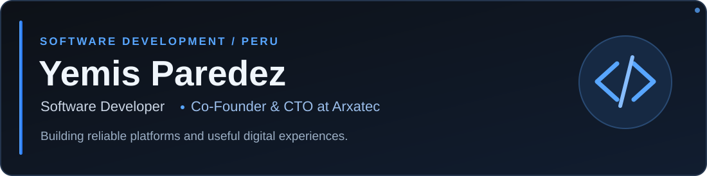
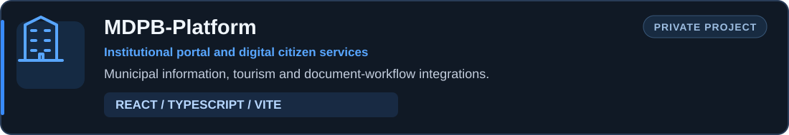
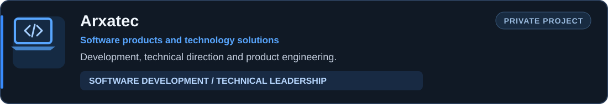

  

  
  
  
  

### About me

I'm a software developer interested in **full-stack engineering**, **software architecture**, and **digital transformation**. I focus on building maintainable web applications and useful digital experiences, including services that improve how people interact with public institutions.

At **Arxatec**, I work as **Co-Founder & CTO**, combining software development with technical direction.

### Tech stack

  

React · TypeScript · JavaScript · HTML · CSS · Node.js · NestJS · PostgreSQL · Python · Git · Vite

### Selected work

Institutional web platform for the **District Municipality of Puerto Bermúdez, Peru**. My work focuses on the public-facing website and integration with existing document-management services, including virtual submissions and public tracking. The underlying document-management system is a separate project.

A software development initiative where I contribute to product engineering and technical direction.

Both projects are private repositories; their source code is not publicly accessible.

### Connect

[GitHub](https://github.com/yens10) · [Portfolio repository](https://github.com/yens10/portafolio)

---

Building useful software with purpose and attention to detail.

